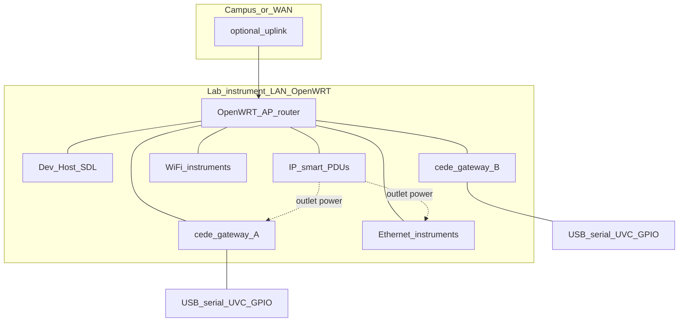

# Lab network gateway proposal

**Status:** project proposal (requirements + topology only). No OpenWRT configs, PDU drivers, or health code in this change set.

**Purpose:** map a mixed instrument floor—exemplified by the SFSU [E-Lab](https://github.com/E-Lab-SFSU)—onto one addressable lab LAN for SDL orchestration, including **power control** and **instrument health**, while keeping today’s CEDE attach semantics (USB/serial/UVC on the **cede-gateway**, campaign/`runs/` on the **Dev-Host**).

E-Lab public platforms ([RoboCam 3.1](https://e-lab-sfsu.github.io/RoboCam3.1/), FlyCam lineage, StentorCam, FlyShock/FlyShaker) are the **requirements exemplar**. This repo does not claim to control that hardware today.

## Naming

| Term | Meaning |
| --- | --- |
| **Lab network gateway** | OpenWRT AP/router: L2/L3 instrument LAN (Ethernet + WiFi, DHCP, DNS/mDNS) |
| **cede-gateway** | CEDE Phase 7 attach host (Pi): USB–RS232, CDC, UVC, CSI-via-Pi, GPIO |
| **Dev-Host** | SDL orchestration, adapters, campaign store, vision, health rollup, gated power actions |
| **IP smart PDU** | Networked power strip on the lab LAN (per-outlet on/off; optional energy) |

Do not collapse “gateway” into one box: the router never exposes `/dev/serial`; the cede-gateway is not the lab DHCP authority.

## Problem

Bench instruments arrive as Ethernet, WiFi, USB serial, UVC, CSI, GPIO, and mains-powered gear. Today this PoC covers USB attach via cede-gateway (LS 55 Prolific, Marlin Mega CDC, C310 UVC) and has **no** lab LAN, PDU, or health plane. A unified network is required before Stage 0 inventory can name IP devices, outlets, and reachability the same way it names USB by-id nodes.

## Requirements

### Interface inventory

| Physical class | Lab examples (E-Lab / this PoC) | Attach path |
| --- | --- | --- |
| USB serial / CDC | Marlin printer boards; LS 55 Prolific USB–RS232 | cede-gateway by-id |
| USB camera | Player One; UVC webcams; Logitech C310 | cede-gateway UVC / vendor USB |
| CSI / Pi-local camera | Raspberry Pi Camera (Picamera2) | cede-gateway host (local) |
| GPIO | Laser/IR stimulus (`lgpio` on Pi 5); FlyShock-class | cede-gateway GPIO |
| IP Ethernet / WiFi | Klipper/Moonraker HTTP (RoboCam backend) | OpenWRT lab LAN |
| Power / PDU | Smart strips for benches, cameras, printers, lamps | OpenWRT lab LAN (prefer IP); USB/GPIO relay via cede-gateway as fallback |
| Local GUI host | RoboCam PySide6 on Pi 5 + NVMe | May coincide with a cede-gateway; campaign/`runs/` stay on Dev-Host |

### Safety

- Named **abort** (or motion-safe stop) remains on the IOP / operator path—not PDU kill.
- **Idle-safe** before intentional power loss (e.g. Xe shutter off, axes stopped).
- **Operator arming** for live actions that energize lamps, move axes, or cycle outlets (`gate_a_pass`-style).
- Lab LAN **isolated** from untrusted campus clients (optional WAN uplink; instruments not exposed as open campus WiFi peers).
- Health checks are **read-mostly** and must not energize lamps or move axes unless operator-armed (same posture as cohort HIL / Gate A).

### Discovery

- IP devices and gateways: stable hostname / DHCP reservation / mDNS on the lab LAN.
- Non-IP devices: USB by-id / V4L by-id on the assigned cede-gateway (CEDE Phase 7).
- Power: inventory binds `instrument_id → outlet_id` (and optionally `gateway_id → outlet_id` for cold boot of attach hosts).

### Data plane

- Durable artifacts and image processing stay on the **Dev-Host** (`runs/`).
- cede-gateway holds only temporary capture files unless a later design explicitly expands that (out of scope here).
- Large RoboCam-class raw bursts remain a host-local concern; the lab LAN carries control/health, not a substitute for NVMe on the capture Pi.

## Topology

**Prose sketch (not a vendor BOM):** one OpenWRT device as AP + router; wired ports and a lab SSID (e.g. `lab.instruments`); Dev-Host, cede-gateways, IP instruments, and IP PDUs as DHCP clients with reservations. Optional uplink to campus/WAN with outbound-only or operator-approved forwarding. No concrete SKU bake-off in this proposal.

### Roles

1. **OpenWRT (lab network gateway)** — DHCP, DNS/mDNS, Ethernet + WiFi for IP instruments and PDUs. Does not expose serial/GPIO.
2. **cede-gateway(s)** — DHCP clients; CEDE Phase 7 attach for USB/serial/UVC/CSI/GPIO. IOP opens nodes; temporary capture only.
3. **Dev-Host** — SDL orchestration; SSH/IOP to gateways; HTTP to IP instruments; **health aggregation** and gated **power actions**.
4. **IP smart PDUs** — per-outlet on/off (+ optional watts); first-class LAN citizens.
5. **Instrument IOP services** — stay outside CEDE (spectrometer-lab, future Marlin/RoboCam-shaped services). Health probes may call IOP `state` / identity; power kill is not IOP abort.

## Instrument mapping (exemplar)

| Class / platform | Control plane | Power binding |
| --- | --- | --- |
| LS 55 (this PoC) | cede-gateway Prolific by-id → spectrometer-lab IOP | Named outlet for instrument (and optionally gateway) |
| Marlin gantry + C310 (this PoC) | Mega CDC + UVC on cede-gateway | Printer / camera / gateway outlets as needed |
| RoboCam Marlin path | USB serial on attach host (cede-gateway) | Motion stage + camera outlets |
| RoboCam Klipper/Moonraker path | HTTP on OpenWRT lab LAN | Controller / Pi / camera outlets |
| Pi Camera / Player One / GPIO laser | cede-gateway local USB/CSI/GPIO | Same bench strip as the attach host when shared |
| FlyShock / FlyShaker-class stimulus | GPIO / specialized USB on cede-gateway | Stimulus hardware on a dedicated outlet where isolation helps |

## Power & health plane

### Power actions (requirements shape)

| Action | Intent |
| --- | --- |
| `outlet_on` | Energize a named outlet |
| `outlet_off` | De-energize |
| `outlet_cycle` | Off → settle delay → on (recovery / cold boot) |
| `outlet_status` | On/off; optional watts / current |

**Safety invariants:** outlet actions are operator-armed and idle-safe-gated; never use PDU kill as the primary abort for motion or lamp instruments; do not power-cycle a cede-gateway mid-capture without Dev-Host coordination. Prefer IP PDUs on the lab LAN; document USB/GPIO relay strips only as edge fallback via cede-gateway.

### Inventory fields (proposal)

Stage 0-style records gain, alongside USB by-id:

- `hostname` / `ip` / `ports` (IP instruments, gateways, PDUs)
- `outlet_id` (and PDU hostname)
- `attach_gateway` + by-id / V4L globs (non-IP)
- `health_probes` (which layers apply)

### Layered health (Dev-Host rollup)

| Layer | Check | Examples |
| --- | --- | --- |
| 1. Power | Outlet on; optional current sane | PDU `outlet_status` |
| 2. Network | Lease / ping / TCP open | Gateway SSH; Moonraker port; PDU API |
| 3. Attach | Device node present | USB by-id, `/dev/v4l/by-id/*`, GPIO export |
| 4. IOP probe | Instrument smoke | LS 55 identity; Marlin `M115`; one-frame capture; HTTP `/api/state` |
| 5. Aggregate | Orchestration gate | `healthy` / `degraded` / `unreachable` / `powered_off` |

Campaigns refuse **live** mode when required devices are not `healthy` (fixture / dry-run unchanged). Cohort HIL ([`instrument_hil_bringup.md`](instrument_hil_bringup.md)) already exercises layer 4 for the first bridge cohort; this proposal adds layers 1–3 and the aggregate gate as Stage 0 inventory requirements—PDU clients and campaign gates still unimplemented.

**Stretch (display, not campaign gate):** [`tools/lab_status.py`](../../../tools/lab_status.py) / `sdl.hil.status` is a Dev-Host read-mostly snapshot of layers 2–4 (gateway SSH, USB/V4L attach, LS 55 identity / Marlin `M115`). It distinguishes LS 55 **ADAPTER** (by-id present, no IOP reply — e.g. instrument powered off) from Marlin **CTRL OK** (Mega answers `M115` even when gantry mains are off; pass `--note` for mains until PDUs exist). [crt-drive](https://github.com/fractalclockwork/crt-drive) `vtty_host_lab` paints a phosphor dashboard (LEDs / clock / rules); local Pico via `make vtty-start HOST=vtty_host_lab`, Pico on cede-pi via `tools/vtty_lab_gateway.sh`. Not layer 1 / not `powered_off` aggregate.

## SDL implications

- **Stage 0 inventory** cites IP identity, `outlet_id`, and health probe hooks the same way it cites CEDE by-id stubs ([`instrument_bringup.md`](instrument_bringup.md)).
- **HIL** may later add reachability / outlet-status checks; attach smoke remains CEDE/IOP territory. Lab-status + CRT VTTY is a display stretch beside HIL, not a live-mode gate.
- **Orchestration** gates live campaigns on aggregate health; power actions stay outside the SOP science loop unless an explicit armed recovery step is designed later.
- Ownership unchanged: CEDE = gateway OS / attach; instrument repos = IOP; SDL = inventory shape, health rollup, gated power ops, science loop. OpenWRT/PDU lab-ops config can live under this proposal until a later CEDE decision. CRT glass painting stays in crt-drive; SDL owns the status JSON.
- No ChemOS / AlabOS / IvoryOS, SiLA 2, or OPC UA adoption.

## Phased proposal (paper only)

| Phase | Scope |
| --- | --- |
| **A** | OpenWRT lab LAN + one cede-gateway + existing LS 55 / Marlin / C310 cohort + one IP PDU + health rollup sketch |
| **B** | Second cede-gateway / GPIO-stimulus benches (FlyShock-class) + expanded outlet map |
| **C** | WiFi/Ethernet instrument enrollment (Klipper-class) + richer health (energy, IOP state) |

## Out of scope (this document)

- Buying or flashing OpenWRT; firewall rule sets; vendor SKU selection.
- PDU vendor SDKs or Python clients; automated unattended power sequencing.
- Replacing RoboCam GUI; moving campaign vision onto gateways.
- SiLA 2 / OPC UA; ChemOS-class adoption.
- CEDE OTA fleet (parked as in CEDE DS-17); changing CEDE Phase 7 DoD.
- PDU outlet APIs or campaign live-mode gates on aggregate health (lab-status / CRT VTTY display stretch is separate).

## Related docs

- Architecture: [`docs/project/architecture.md`](../architecture.md)
- Instrument bringup ladder: [`instrument_bringup.md`](instrument_bringup.md)
- Stage 0 HIL (LS 55 + Marlin + C310): [`instrument_hil_bringup.md`](instrument_hil_bringup.md)
- Lab status CLI (layers 2–4 display): [`tools/lab_status.py`](../../../tools/lab_status.py)
- CRT VTTY lab page: [crt-drive `vtty_host_lab.py`](https://github.com/fractalclockwork/crt-drive/blob/main/tools/vtty_host_lab.py)
- Marlin + C310: [`marlin_c310_bringup.md`](marlin_c310_bringup.md)
- Continuous instrument peers: [`docs/project/research.md`](../research.md)
- CEDE: [DEV_OP Phase 7](https://github.com/fractalclockwork/cede/blob/main/docs/DEV_OP.md), [lab.example.yaml](https://github.com/fractalclockwork/cede/blob/main/config/lab.example.yaml)
- E-Lab exemplar: [E-Lab-SFSU](https://github.com/E-Lab-SFSU), [RoboCam 3.1 docs](https://e-lab-sfsu.github.io/RoboCam3.1/)
