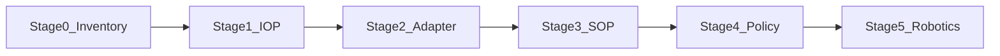

# Instrument bringup roadmap

Canonical ladder for bringing lab instruments into this PoC. This repo owns orchestration, decision, and data; instrument operating procedures (IOPs) stay in a dedicated service when possible (spectrometer-lab for the LS 55). Every new device climbs the same stages; the LS 55 is the gold-standard example.

**Terminology:** Ladder **stages** (0–5) are maturity levels in this document. Spectrometer-lab **Gate A / Gate D** are hardware safety and seating qualifications — not ladder stages. Older docs that said “Stage 4+ robotics” mean **Stage 5** here.

## Bringup ladder

| Stage | Name | LS 55 evidence today | Exit criteria (generic) |
| --- | --- | --- | --- |
| 0 | Inventory & safety | Serial/port, Xe/shutter, Gate A/D language in spectrometer-lab | Physical I/O known; hazards and abort path named |
| 1 | IOP owned elsewhere or stubbed | spectrometer-lab FastAPI on `:8055` | Device mechanics behind a stable API; SDL never parses the wire protocol |
| 2 | Integration adapter | [`src/sdl/integration/ls55_client.py`](../../src/sdl/integration/ls55_client.py) — `LS55Client`, HTTP + fixture | Protocol + live client + offline fixture; normalized result types |
| 3 | Operator-gated SOP | [`TonicDilutionSOP`](../../src/sdl/orchestration/sops/tonic_dilution.py) + [`CampaignRunner`](../../src/sdl/orchestration/runner.py) | Propose → `OperatorGate` → execute → persist |
| 4 | Closed-loop policy | [`ClipSNRDilutionPolicy`](../../src/sdl/decision/policy.py) + [tonic dilution use-case](../use_cases/tonic_dilution.md) | Adaptive next-action from measurements; explicit stop conditions |
| 5 | Robotics / unattended | Deferred | Sample prep / transport no longer human-actuated |

### Safety invariants (all stages)

- Named **abort** (or motion-safe stop) reachable by the operator.
- Documented **idle-safe** posture (e.g. Xe shutter off, axes stopped).
- **Operator arming** before live actions that can energize lamps, move axes, or open compartments (`gate_a_pass`-style where applicable).
- Fixture / dry-run mode must not require factory seating (Gate D) or live hardware.

## Instrument scoreboard

| Instrument | Ladder status | Notes |
| --- | --- | --- |
| **PerkinElmer LS 55** | **Stage 4** for tonic / IFE onset | Adapter, SOP, policy, and fixture CI exist. Gate D seating still open for factory-qualified bench claims. Stage 5 out of scope for v1. |
| **Marlin gantry + camera** | **Stage 0–1 next**; Stages 2–5 open | See sequence below. First closed-loop policy undecided. |

### North star (gantry + camera)

Not a committed first loop — a direction of travel:

1. **Camera positioning** — home, move to named waypoints, report pose; grab frames for provenance.
2. **Lighting / exposure control** — repeatable illumination and capture settings tied to waypoints or SOP steps.
3. **Sample prep assist → automate** — eventually replace or reduce operator prompts that today dilute, load, and acknowledge in the tonic campaign.

Whether the first Stage-4 policy is load-verify, transport, lighting quality, or something else is deferred until Stage 2–3 clients and a waypoint SOP exist.

## Shared adapter contract

Mirror the LS 55 pattern for every instrument:

- **Protocol surface** with at least `connect`, `state`, and `abort` (or motion-safe idle / estop).
- **Live client** talking only to the IOP API — SOPs never emit G-code, RS-232, USB, or V4L calls.
- **Offline fixture** double for CI and dry-run campaigns.
- **Normalized observations** written into the campaign store (`runs/<id>/`), not raw wire dumps as the SOP’s primary result type.
- Optional device-specific setup (optics, home, exposure) stays on the adapter, not in the policy.

## Suggested sequence: Marlin gantry + camera

Planning only — no clients in this change.

1. **Stage 0** — Inventory serial port / baud for Marlin, camera device path, workspace limits, and estop / soft-stop story.
2. **Stage 1** — Minimal Marlin IOP: home, move XYZ, report position; separate or co-located frame-grab endpoint. Keep G-code and camera IO out of this repo.
3. **Stage 2** — SDL `GantryClient` / `CameraClient` (or one combined motion+vision protocol) + HTTP (or equivalent) live clients + fixtures that return fake poses / frames.
4. **Stage 3** — Operator-gated waypoint SOP (move → capture → persist) via `CampaignRunner`.
5. **Stage 4+** — Choose first adaptive policy (load-verify vs lighting vs prep assist) once adapters and the waypoint SOP are real.
6. **Stage 5** — Unattended prep / transport that can stand in for today’s human sample-prep actuator in tonic dilution.

## Out of scope (this document)

- Implementing gantry/camera Python clients or IOPs.
- ChemOS / AlabOS / IvoryOS, SiLA 2 / OPC UA.
- Completing LS 55 Gate D hardware qualification.
- Choosing the first gantry+camera closed-loop science question.

## Related docs

- Architecture: [`docs/architecture.md`](../architecture.md)
- Use-case (LS 55 Stage 4 example): [`docs/use_cases/tonic_dilution.md`](../use_cases/tonic_dilution.md)
- Industry stack context: [`docs/vendor/landscape.md`](../vendor/landscape.md)
