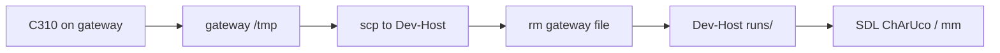

# Marlin + C310 bring-up (prep-area ChArUco)

Stage **0** remainder and data-plane rules for the gantry + Logitech C310 cohort. Attach attestation is already covered by [`instrument_hil_bringup.md`](instrument_hil_bringup.md). This note locks the printable calibration card and where frames / vision live.

## Data plane (invariant)

| Role | Owns | Does not own |
| --- | --- | --- |
| **cede-gateway** | USB attach (Mega CDC, C310 UVC); short-lived capture under `/tmp` | Durable frames, campaign `runs/`, OpenCV / ChArUco |
| **Dev-Host** | HIL/campaign runner; `runs/`; all image processing (detect, scale, mm) | Opening bench USB as the default path |

Canonical HIL path: run on the **Dev-Host** with `--ssh-gateway`. Capture on the gateway writes `/tmp`, then `scp` to Dev-Host `runs/hil_<utc>/c310.jpg`, then delete the remote file. Pi-local HIL is attach smoke only — not the campaign store.

ChArUco detection and dimensional metrology are **SDL on the Dev-Host** after the frame is local. Do **not** model this loop as a spectrometer-lab-style HTTP vision IOP; that HTTP shape fits a modern spectrometer better. Motion may still use an external Marlin IOP later; frame grab may be HIL/`scp` or a thin helper — neither keeps frames on the gateway nor runs detection there.



CEDE’s “instrument host” language means **attach** host (by-id serial/UVC), not the campaign or vision host.

## Printable card

Committed targets (print at **100% / actual size**):

| File | Use |
| --- | --- |
| [`docs/calibration/prep_area_charuco_letter.pdf`](../calibration/prep_area_charuco_letter.pdf) | US Letter |
| [`docs/calibration/prep_area_charuco_a4.pdf`](../calibration/prep_area_charuco_a4.pdf) | A4 |
| [`docs/calibration/prep_area_charuco.json`](../calibration/prep_area_charuco.json) | Manifest (`sdl-prep-charuco-v1`) |

Geometry: OpenCV `DICT_4X4_50`, **5×7** squares, square **24.0 mm**, marker **18.0 mm** (board **120×168 mm**), vector **100 mm** scale bar for a ruler check. Regenerate (Dev-Host only):

```bash
uv sync --extra calibration
uv run python tools/prep_area_charuco_card.py --out-dir docs/calibration
```

## Stage 0 checklist (operator)

1. Print Letter or A4 PDF at actual size; confirm the **100 mm** bar with a ruler.
2. Place the card flat in the prep field of view (no motion yet).
3. From Dev-Host: run cohort HIL with `--ssh-gateway` so the C310 frame lands under `runs/hil_*/c310.jpg`.
4. Record workspace limits and the estop / soft-stop story **before** any `G0` / home (still deferred — do not invent travel limits in software here).
5. Do not wire Mega stubs into Hello Lab Uno resolvers (`usb-Arduino_*` also matches Mega).

## Ladder next steps

See [`instrument_bringup.md`](instrument_bringup.md) and [`prep_area_dimensional.md`](../use_cases/prep_area_dimensional.md). Stages 1–4 stay planning until motion/capture clients exist; vision policy and ChArUco detect remain Dev-Host SDL work.

## Related

- HIL tool: [`instrument_hil_bringup.md`](instrument_hil_bringup.md)
- Ladder: [`instrument_bringup.md`](instrument_bringup.md)
- Use-case: [`prep_area_dimensional.md`](../use_cases/prep_area_dimensional.md)
