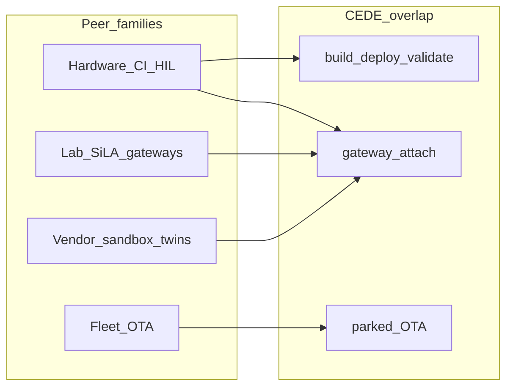

# Continuous instrument & embedded development — peer landscape

Research note: existing solutions that overlap **[CEDE](https://github.com/fractalclockwork/cede)**’s claim of continuous development against real lab hardware. Complements the broader SDL stack in [`landscape.md`](landscape.md). This PoC keeps CEDE as the physical plane; peers below are context, not adoption targets.

## Definition (CEDE framing)

**Continuous instrument development** here means:

1. **Build** — reproducible toolchains (containers) produce an artifact + identity.
2. **Deploy** — flash or sync that artifact onto lab hardware (direct-attach or gateway).
3. **Validate** — attest what is running (e.g. serial banner / digest).
4. **Attach** — stable discovery of serial / UVC / USB nodes so **instrument IOPs** (external repos) and **SDL** adapters can talk without Dev-Host USB as the default bench path.

SDL orchestration (ChemOS-class), SiLA device APIs, and vendor closed-loop measurement APIs assume some physical plane; they rarely specify build→deploy→validate for firmware or multi-instrument gateway attach. That gap is why [`architecture.md`](../architecture.md) names `physical_control_plane` → CEDE.

## 1. Hardware CI / HIL gateways (closest to CEDE MCU loop)

| Project | Pattern | Overlap with CEDE | Difference |
| --- | --- | --- | --- |
| [Lager](https://www.lagerdata.com/) | Self-hosted “Lagerbox”; flash + instruments + CI (GitHub Actions); Apache 2.0 | Networked bench, flash/test, scriptable attach | Broader instrument control (scopes, PSUs); not SDL/IOP-oriented |
| [labgrid](https://github.com/labgrid-project/labgrid) | Python board control + remote exporter; pytest | Serial/power/USB/flash abstraction; remote host | Embedded Linux/board focus; no Docker toolchain matrix like CEDE Target Types |
| [Linaro LAA](https://hub.linaro.com/laa) + LAVA | One appliance per DUT; LAVA/GitLab/labgrid runtimes | Gateway appliance, power/USB/serial, CI worker | Fleet LMS / outbound HTTPS; heavier than Pi Hello Lab |
| [BenchPod / EmbeddedCI](https://www.embeddedci.com/resources/meet-the-benchpod) | Networked SWD + UART + power + analog API/pytest | CI-driven flash + banner-style validate | Commercial pod; DUT-centric HIL, not multi-instrument lab host |
| [Cuica](https://docs.cuica.io/introduction/overview) | CI↔DUT bridge; REST + MicroPython test scripts | Artifact flash + validate from CI | Fixture-centric product; not SDL Phase 7 instrument host |
| [HW Puppet](https://github.com/Vasencheg/hw-puppet) / similar | Cheap ESP32 HIL bridge | USB serial + control for CI/agents | Single-board puppet, not Dev-Host Docker + Pi gateway |

**CEDE analogy:** DS-7 `build` / `deploy` / `validate` / `debug` + Dev-Host Docker toolchains + cede-gateway SSH flash (`hw-smoke`).

## 2. Lab digitization gateways (closest to CEDE Phase 7 instrument host)

| Project | Pattern | Overlap | Difference |
| --- | --- | --- | --- |
| [SLAS Technology 2025 Gateway Module](https://www.slas-technology.org/article/S2472-6303(25)00139-6/fulltext) + SiLA 2 Docker drivers | SBC USB/RS-232 → SiLA 2 containers; OS image vs driver update split | Gateway as physical attach + containerized IOP-like drivers | Standard is SiLA 2; CEDE stays attach-only and leaves IOP in instrument repos |
| SiLA Installer / UniteLabs-style platforms | Central install/update of automation software | Continuous **software** deploy to lab nodes | Application fleet mgmt, not MCU build identity |
| [Tecan SiLA2 SDK](https://www.slas-technology.org/article/S2472-6303(23)00044-4/fulltext) / [QPillars OpenAPI→SiLA](https://qpillars.com/sila2-studio) | Generate drivers + Docker/tests | CI-friendly driver packaging | Protocol generation, not flash/validate MCUs |

**CEDE analogy:** Phase 7 onboarding contract (USB by-id identity, `lab.yaml` stub, `dialout`/`video`, external IOP owner) without absorbing SiLA or spectrometer/Marlin protocol.

## 3. Vendor SDL instrument APIs (orchestration seam, not embedded CI)

| Project | Pattern | Overlap | Difference |
| --- | --- | --- | --- |
| [Rigaku RAI / LabLinc Studio](https://rigaku.com/products/lablinc-studio) | Python orchestration, sandbox, digital twin before live | Safe iterate on instrument workflows | Closed-loop **measurement** API; not firmware build/deploy/validate |
| ChemOS / AlabOS / IvoryOS / PyLabRobot (see [`landscape.md`](landscape.md)) | SOP/IOP orchestration | SDL science loop | No continuous embedded plane |

**CEDE analogy:** None for MCU flash. SDL HTTP adapters already mirror “talk IOP API, not wire.”

## 4. Fleet OTA (CEDE future / DS-17 parked)

| Project | Pattern | Note |
| --- | --- | --- |
| [Mender](https://mender.io/), [balenaCloud](https://www.balena.io/) | OTA OS/app fleets on industrial gateways | Matches CEDE “OTA as future Flash Method”; out of scope for Phase 7 DoD |

## CEDE positioning for this PoC

| Need | Peer family | This PoC choice |
| --- | --- | --- |
| MCU continuous build/flash/attest | Hardware CI / HIL (§1) | **CEDE** Dev-Host + gateway |
| Stable serial/UVC host for LS 55, Marlin, C310 | Lab gateways (§2) | **CEDE** Phase 7 attach; IOP stays in instrument repos |
| Science loop / measurement API | Vendor + SDL orchestrators (§3) | **self-driving-lab** + spectrometer-lab (etc.) |
| Wireless fleet OTA | Mender/balena (§4) | Parked (CEDE DS-17) |

CEDE is not inventing networked flash+serial from nothing — it sits in a known hardware-CI peer set — while remaining the chosen physical plane for SDL Stage 0 inventory and instrument bringup ([`instrument_bringup.md`](../roadmap/instrument_bringup.md)).

## Non-goals (this note)

- Adopting Lager, labgrid, LAA, BenchPod, Cuica, or SiLA as replacements.
- Product bake-off or CI runner implementation.
- Changing CEDE Phase 7 DoD (no IOP in CEDE; `hw-smoke` unchanged).

## Related

- Architecture physical plane: [`docs/architecture.md`](../architecture.md)
- Instrument bringup: [`docs/roadmap/instrument_bringup.md`](../roadmap/instrument_bringup.md)
- Industry SDL stack (orchestration / SiLA overview): [`docs/vendor/landscape.md`](landscape.md)
- CEDE: [DEV_OP Phase 7](https://github.com/fractalclockwork/cede/blob/main/docs/DEV_OP.md), [DS-7 / DS-17](https://github.com/fractalclockwork/cede/blob/main/docs/DESIGN_SPECIFICATION.md)
